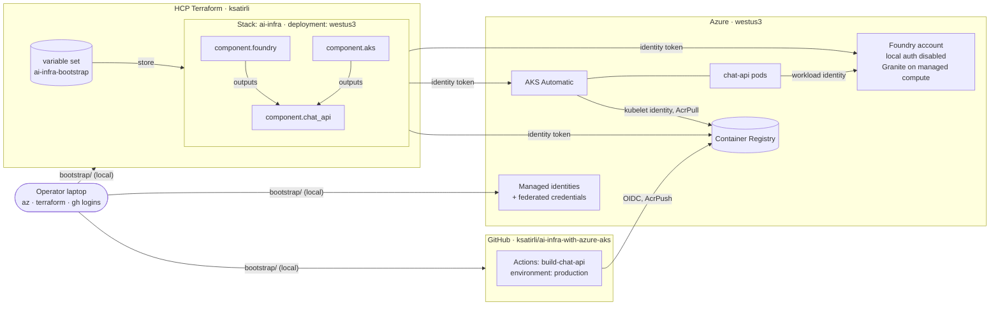

# AI Infrastructure with Azure AKS

> Deploy Microsoft Foundry and an AKS Automatic workload that uses it, with an HCP Terraform
Stack and Azure Verified Modules, in a way that no secret reaches the pipeline.

- **Microsoft Foundry** hosts **IBM Granite 4.2 30B** on Foundry managed compute.
- **AKS Automatic** runs a small chat API that calls Foundry using workload identity.
- **A Terraform Stack** in HCP Terraform deploys the resources.
- **GitHub Actions** builds the image and pushes it to ACR.

## Architecture



| Layer | Path | Runs where, as | Creates |
| --- | --- | --- | --- |
| Bootstrap | `bootstrap/` | locally, with your `az`, `terraform` and `gh` logins | resource groups, the Stack identity, the GitHub Actions identity, role assignments, the HCP Terraform project, Stack and variable set, the GitHub environment and its variables |
| Stack | `*.tfcomponent.hcl`, `*.tfdeploy.hcl` | HCP Terraform, `id-aiaks-stack` via identity token | one `westus3` deployment of the three components below |
| ↳ foundry | `components/foundry/` | | Foundry account, project, Granite managed compute deployment |
| ↳ aks | `components/aks/` | | AKS Automatic, ACR, kubelet `AcrPull` |
| ↳ chat_api | `components/chat-api/` | | chat API identity and Foundry role, Kubernetes namespace, service account, deployment, service |
| App | `app/`, `.github/workflows/` | GitHub Actions, `id-aiaks-github-actions` via OIDC | `chat-api` image in ACR |

The `chat_api` component configures its Kubernetes provider from the cluster the
`aks` component creates in the same run. HCP Terraform **defers** it until the
cluster exists, then plans it again, so a first deployment needs no `-target`.

## Azure Verified Modules

| Module | Version | Used in |
| --- | --- | --- |
| [`avm-res-resources-resourcegroup`](https://registry.terraform.io/modules/Azure/avm-res-resources-resourcegroup/azurerm) | 0.5.0 | bootstrap |
| [`avm-res-managedidentity-userassignedidentity`](https://registry.terraform.io/modules/Azure/avm-res-managedidentity-userassignedidentity/azurerm) | 0.6.0 | bootstrap, chat_api |
| [`avm-ptn-aiml-ai-foundry`](https://registry.terraform.io/modules/Azure/avm-ptn-aiml-ai-foundry/azurerm) | 0.14.0 | foundry |
| [`avm-res-containerservice-managedcluster`](https://registry.terraform.io/modules/Azure/avm-res-containerservice-managedcluster/azurerm) | 0.9.0 | aks |
| [`avm-res-containerregistry-registry`](https://registry.terraform.io/modules/Azure/avm-res-containerregistry-registry/azurerm) | 0.9.0 | aks |

The Granite deployment (`Microsoft.CognitiveServices/accounts/managedComputeDeployments`,
API `2026-09-15-preview`) is not covered by an AVM module yet, so the `foundry`
component creates it with a single `azapi_resource` on the account the AVM pattern
module builds.

All modules require `azurerm` 4.x, so the configs pin `>= 4.81.0, < 5.0.0` (the
latest 4.x).

## The trust chain

Every hop uses a federated credential: a token from one issuer is exchanged for
a short-lived Entra ID token, and that exchange only works for one exact subject.

| Caller | Token issuer | Trusted subject | Azure identity | Can do |
| --- | --- | --- | --- | --- |
| Stack plan / apply | `app.terraform.io` | `organization:ksatirli:project:ai-infra-with-azure-aks:stack:ai-infra:deployment:westus3:operation:{plan,apply}` | stack | Contributor and AKS RBAC Cluster Admin on the workload resource group; may assign only `AcrPull` and `Foundry User` |
| Image build | `token.actions.githubusercontent.com` | `repo:ksatirli@<owner id>/ai-infra-with-azure-aks@<repo id>:environment:production` (GitHub's immutable subject) | github-actions | Reader and `AcrPush` on the workload resource group |
| chat-api pod | AKS OIDC issuer | `system:serviceaccount:chat:chat-api` | chat-api | `Foundry User` (formerly `Azure AI User`) on the Foundry account |

Identities live in their own resource group, so the Stack cannot change its own
identity or federated credentials.

### Ephemeral by design

| Credential | How it stays out of state |
| --- | --- |
| GitHub CLI token (bootstrap) | ephemeral input variable `github_token` |
| HCP Terraform CLI login (bootstrap) | read by the `tfe` provider from the CLI credentials file |
| Azure CLI login (bootstrap) | used by `azurerm` / `azapi` directly |
| Stack Azure tokens | `identity_token "azure"`, passed to an `ephemeral` Stack variable and used only in provider config |
| AKS API token | exec plugin in `providers.tfcomponent.hcl` that swaps the identity token for an Entra ID token on the runner |
| Pod token for Foundry (Granite) | projected service account token, exchanged by `DefaultAzureCredential` |
| GitHub Actions Azure token | GitHub OIDC via `azure/login` |

The cluster CA certificate is read with a regular (non-ephemeral) data source,
because component outputs cannot be ephemeral. An Entra ID cluster's user
kubeconfig holds only the server URL and the public CA, never credentials.

## Requirements

- An Azure subscription where you are Owner (or Contributor and User Access Administrator),
  with managed compute A100 quota (see Notes).
- An HCP Terraform organization with Terraform Stacks enabled.
- The [HCP Terraform GitHub App](https://developer.hashicorp.com/terraform/cloud-docs/vcs/github-app)
  installed on the organization.
- `az`, `gh`, and `terraform` ≥ 1.17.

## Usage

```sh
# 1. Bootstrap, locally, with your own CLI sessions
az login
terraform login
gh auth login

cd bootstrap
terraform init
TF_VAR_github_token="$(gh auth token)" \
TF_VAR_subscription_id="$(az account show --query id -o tsv)" \
terraform apply

# 2. HCP Terraform fetches the Stack configuration, plans the westus3
#    deployment and auto-approves it; the deferred chat_api plan follows.

# 3. Build and push the image
gh workflow run build-chat-api
```

Then call the API using the `try_it` output of the `westus3` deployment:

```sh
curl -s -X POST http://<ip>/chat -H 'content-type: application/json' \
  -d '{"message":"Hello from AKS Automatic"}'
```

## Notes

- **GPU quota:** managed compute has its own quota per accelerator family, separate from VM quota.

  ```sh
  az rest --method get --url "https://management.azure.com/subscriptions/$(az account show --query id -o tsv)/providers/Microsoft.CognitiveServices/locations/westus3/managedComputeUsages?api-version=2026-09-15-preview"
  ```

- **Bootstrap state** is local (`bootstrap/terraform.tfstate`, gitignored) and holds identifiers only.

## License

Licensed under the Apache License, Version 2.0 (the "License").

You may obtain a copy of the License at [apache.org/licenses/LICENSE-2.0](http://www.apache.org/licenses/LICENSE-2.0).

Unless required by applicable law or agreed to in writing, software distributed under the License is distributed on an _"AS IS"_ basis, without WARRANTIES or conditions of any kind, either express or implied.

See the License for the specific language governing permissions and limitations under the License.
